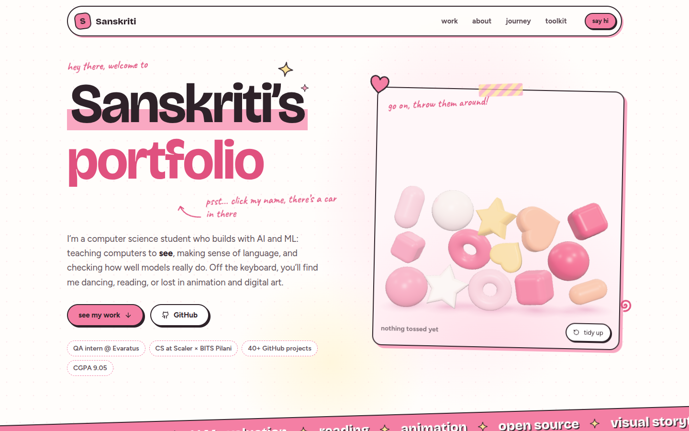
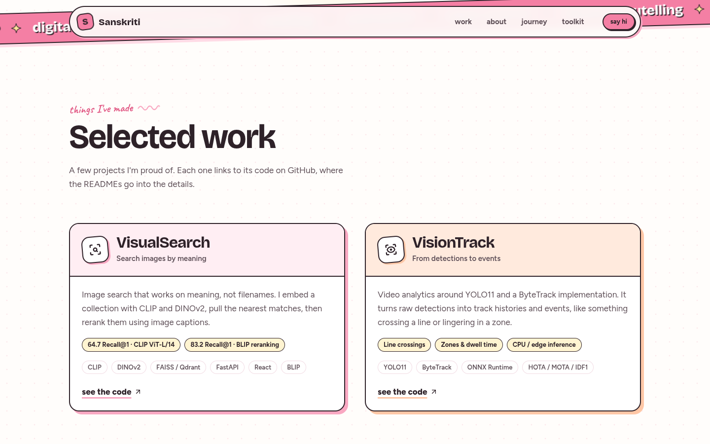
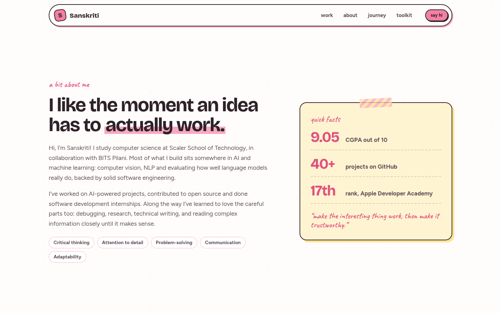
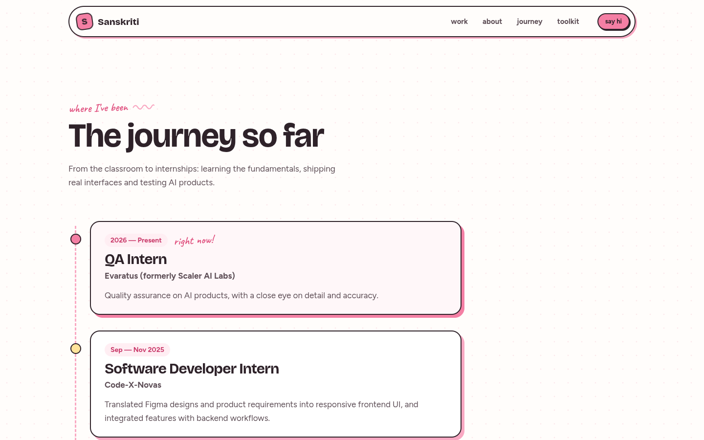
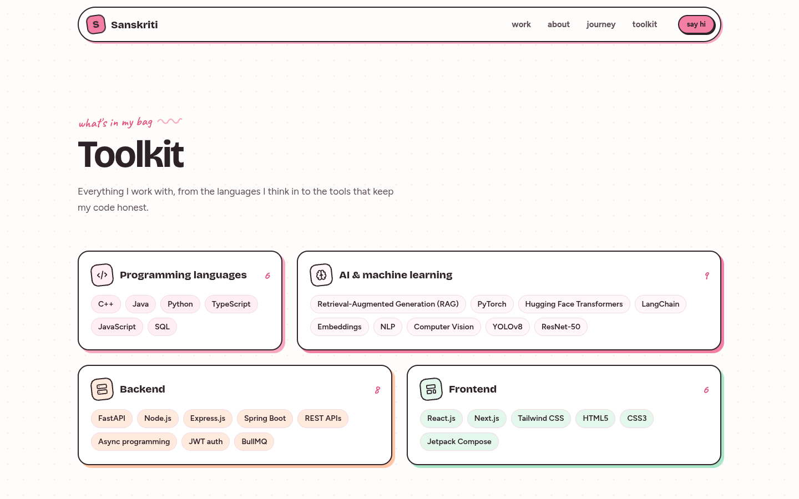
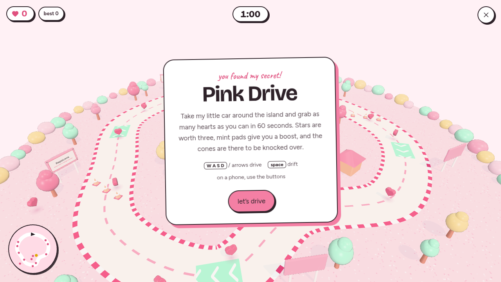
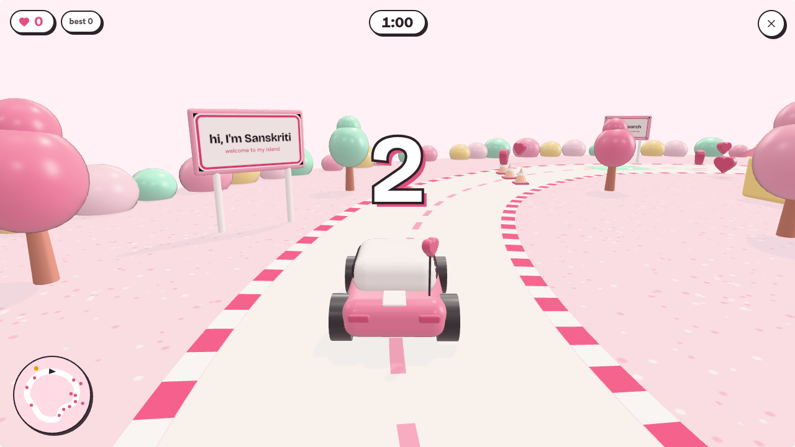
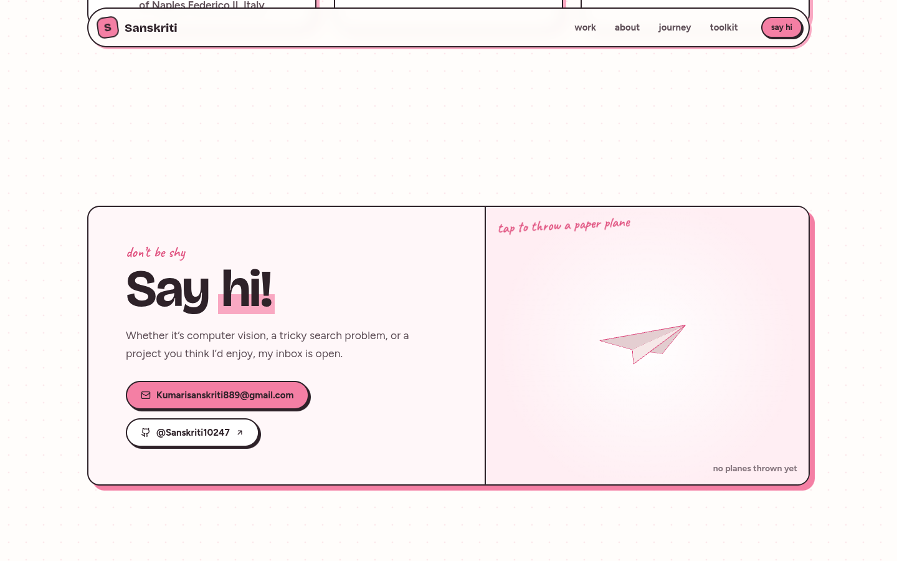
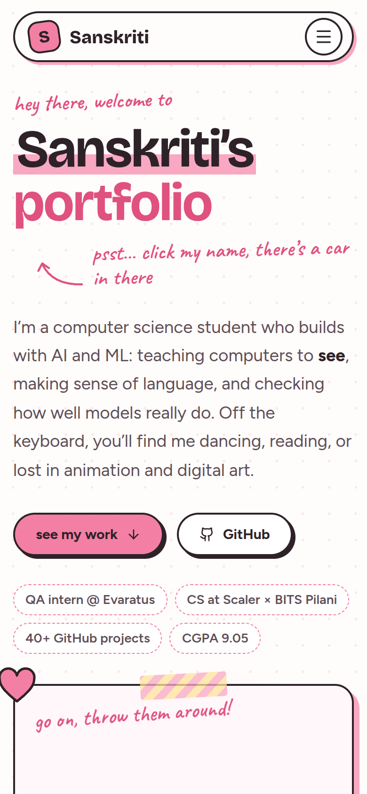
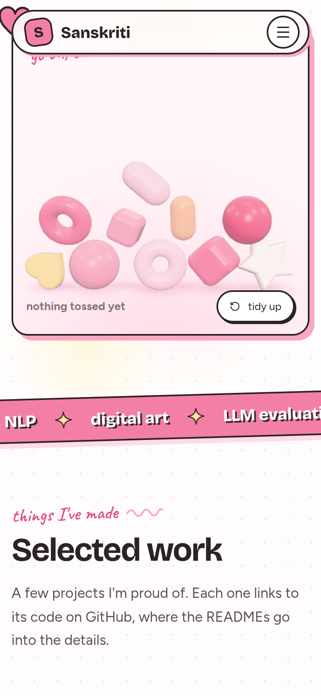

<div align="center">

# Sanskriti's Portfolio

**An interactive personal portfolio built with React, TypeScript and Three.js**

Computer Science · Scaler School of Technology in collaboration with BITS Pilani




</div>

---

## Table of contents

1. [Overview](#overview)
2. [Features](#features)
3. [Screenshots](#screenshots)
4. [Technology stack](#technology-stack)
5. [Getting started](#getting-started)
6. [Project structure](#project-structure)
7. [Architecture](#architecture)
8. [Accessibility and performance](#accessibility-and-performance)
9. [Updating the content](#updating-the-content)
10. [Deployment](#deployment)
11. [Contact](#contact)
12. [License](#license)

---

## Overview

This repository contains the source code of my personal portfolio website. It presents my projects, background, experience, technical skills and achievements in a soft white-and-pink design, with interactive 3D elements built directly on Three.js.

The site also contains a hidden feature: selecting the heading **"Sanskriti's portfolio"** opens **Pink Drive**, a small 3D driving game set on an island.

## Features

### Portfolio

| Section           | Description                                                                                                           |
| ----------------- | --------------------------------------------------------------------------------------------------------------------- |
| **Hero**          | Introduction, key facts, and an interactive 3D toy box                                                                |
| **Selected work** | VisualSearch, VisionTrack, RepoLens, AgentEval and applied ML explorations, with results and repository links         |
| **About**         | Background, strengths, quick facts, hobbies and creative interests                                                    |
| **Journey**       | QA Intern at Evaratus (formerly Scaler AI Labs), Software Developer Intern at Code-X-Novas, and undergraduate studies |
| **Toolkit**       | Technical skills in seven categories                                                                                  |
| **Little wins**   | Apple Developer Academy (rank 17), Meta Hackathon (top 800 teams), SIH finalist                                       |
| **Contact**       | Email and GitHub links, with an interactive paper plane                                                               |

### Interactive 3D

- **Toy box.** Soft 3D toys that can be picked up, dragged and thrown, driven by a custom 2D physics step with collisions, bouncing and squash-and-stretch.
- **Paper plane.** A folded plane in the contact section that flies when the visitor taps around it.

### Pink Drive (hidden game)

- An arcade car with acceleration, braking, steering and drifting
- A looping road with kerbs, scenery, billboards and collision with obstacles
- Hearts (1 point) and stars (3 points) to collect, boost pads, and cones that can be knocked over
- A chase camera, real-time shadows, particles and a minimap
- 60-second rounds with a countdown, and a best score saved in the browser
- Keyboard controls (`W A S D` or arrow keys, `Space` to drift, `R` to restart, `Esc` to exit) and on-screen touch controls for phones

## Screenshots

<table>
  <tr>
    <td width="50%"><p align="center"><sub>Selected work</sub></p></td>
    <td width="50%"><p align="center"><sub>About</sub></p></td>
  </tr>
  <tr>
    <td width="50%"><p align="center"><sub>Journey</sub></p></td>
    <td width="50%"><p align="center"><sub>Toolkit</sub></p></td>
  </tr>
  <tr>
    <td width="50%"><p align="center"><sub>Pink Drive: start screen</sub></p></td>
    <td width="50%"><p align="center"><sub>Pink Drive: gameplay</sub></p></td>
  </tr>
  <tr>
    <td width="50%"><p align="center"><sub>Contact</sub></p></td>
    <td width="50%">
      <table>
        <tr>
          <td></td>
          <td></td>
        </tr>
      </table>
      <p align="center"><sub>Mobile layout</sub></p>
    </td>
  </tr>
</table>

## Technology stack

| Area          | Tools                                                              |
| ------------- | ------------------------------------------------------------------ |
| Framework     | React 19, TypeScript 5.9                                           |
| 3D graphics   | Three.js (custom scenes, materials, lighting, shadows and physics) |
| Build tooling | Vite 7                                                             |
| Styling       | CSS Modules with design tokens (no CSS framework)                  |
| Icons         | Lucide                                                             |
| Code quality  | ESLint, Prettier, strict TypeScript                                |

No physics engine or game engine is used. The physics, car handling and game loop are written from scratch.

## Getting started

### Requirements

- Node.js 24 LTS
- pnpm (npm or yarn also work)

### Installation

```bash
git clone https://github.com/Sanskriti10247/Sanskriti-s-New-Portfolio.git
cd Sanskriti-s-New-Portfolio
pnpm install
```

### Available scripts

| Command          | Description                                       |
| ---------------- | ------------------------------------------------- |
| `pnpm dev`       | Starts the development server at `localhost:5173` |
| `pnpm build`     | Creates a production build in `dist/public`       |
| `pnpm serve`     | Serves the production build locally               |
| `pnpm typecheck` | Runs the TypeScript compiler                      |
| `pnpm lint`      | Runs ESLint                                       |
| `pnpm format`    | Formats the code with Prettier                    |

### Environment variables (optional)

| Variable    | Default | Description                                      |
| ----------- | ------- | ------------------------------------------------ |
| `PORT`      | `5173`  | Port used by the development and preview servers |
| `BASE_PATH` | `/`     | Base URL the site is served from                 |

## Project structure

```
.
├── docs/screenshots/      Images used in this README
├── public/                Static files (favicon, robots.txt)
├── src/
│   ├── content/           All site text as typed data (projects, experience, skills, about)
│   ├── components/
│   │   ├── layout/        Header and footer
│   │   ├── sections/      One component per page section
│   │   ├── game/          Full-screen game overlay: HUD, panels, touch controls
│   │   ├── three/         <ThreeCanvas>, which mounts a 3D scene with a fallback
│   │   └── ui/            Shared pieces: section headings, tags, doodles
│   ├── three/
│   │   ├── core/          Renderer stage, input, physics, lighting, materials, toy shapes
│   │   └── scenes/        Toy box and paper plane scenes
│   ├── game/              Pink Drive, independent of React
│   │   ├── world/         Track and scenery
│   │   ├── entities/      Car, collectibles, cones, boost pads, particles
│   │   ├── input.ts       Keyboard and touch input
│   │   ├── minimap.ts     2D minimap
│   │   └── createDriveGame.ts   Game loop, rounds, scoring and camera
│   ├── hooks/             Scroll reveal, visibility, reduced motion, WebGL support
│   ├── lib/               Shared helpers (scroll store, WebGL detection, scene pausing)
│   └── styles/            Design tokens and base styles
├── index.html
└── vite.config.ts
```

## Architecture

- **Content is separate from layout.** All text lives in `src/content/` as typed data, so the content can be updated without touching any component.
- **3D scenes are plain functions.** Each scene receives a Three.js scene and camera and returns its `update`, `resize` and pointer handlers. A shared `createStage` module handles everything else: renderer setup, resizing, pointer input, pausing off-screen or in a hidden tab, WebGL context loss, reduced motion, and disposing of every resource.
- **The game is independent of React.** `createDriveGame(canvas, minimap, onHud)` returns a small `start / restart / setTouch / dispose` interface. React only renders the HUD from the state the game reports.
- **Code splitting.** The game and its 3D world are loaded only when the game is opened, and Three.js is kept in a separate cached chunk.
- **One scene at a time.** While the game is open, the other 3D scenes on the page pause so the GPU is used only for the game.

## Accessibility and performance

- Every 3D scene has a text description and a static fallback when WebGL is not available.
- With _reduce motion_ enabled, scenes render a single still frame and scroll animations are turned off.
- The game is an accessible dialog: focus moves into it, `Esc` closes it, and focus returns to the heading afterwards.
- Scenes render only while they are visible on screen, and the pixel ratio is limited on smaller devices.
- The layout is responsive from small phones to wide desktop screens.

## Updating the content

| To change…            | Edit                         |
| --------------------- | ---------------------------- |
| Projects              | `src/content/projects.ts`    |
| Experience / journey  | `src/content/experience.ts`  |
| Technical skills      | `src/content/skills.ts`      |
| About, hobbies, facts | `src/content/about.ts`       |
| Achievements          | `src/content/recognition.ts` |
| Name, email, GitHub   | `src/content/profile.ts`     |
| Colours and fonts     | `src/styles/tokens.css`      |

## Deployment

### Vercel (free Hobby plan)

The repository is ready to import into Vercel as a static Vite project. No backend,
database, paid add-on or domain purchase is needed. Use the free Hobby plan for
this personal portfolio and keep the provided `vercel.app` address.

1. Sign in to [Vercel](https://vercel.com) with GitHub on a personal Hobby account.
2. Select **Add New → Project** and import `Sanskriti10247/Sanskriti-s-New-Portfolio`.
3. Authorize access to this repository if GitHub requests it.
4. Keep the following settings, then select **Deploy**:

| Setting               | Value                                                            |
| --------------------- | ---------------------------------------------------------------- |
| Production branch     | `main`                                                           |
| Framework preset      | `Vite`                                                           |
| Root directory        | Repository root (`./`); leave the root directory field unchanged |
| Node.js version       | `24.x`                                                           |
| Install command       | `npx --yes pnpm@10.26.1 install --frozen-lockfile`               |
| Build command         | `pnpm run build`                                                 |
| Output directory      | `dist/public`                                                    |
| Environment variables | None                                                             |

`vercel.json` supplies the framework, install, build, output and routing settings.
`package.json` pins Node.js and pnpm, and `pnpm-lock.yaml` locks the dependencies.
The GitHub repository already contains only the portfolio, so do **not** set the
root directory to `artifacts/sanskriti-portfolio`.

Do not copy development secrets into Vercel. Neither `GITHUB_TOKEN` nor
`SESSION_SECRET` is used by the website. Leave `BASE_PATH` and `PORT` unset:
the site defaults to the domain root, and Vercel serves the compiled static files.

The routing fallback serves `index.html` for non-file paths. Existing static files
(including `/Sanskriti-Resume.pdf`, `/favicon.svg`, `/robots.txt` and bundled
JavaScript/CSS) remain directly accessible. Page navigation uses hash anchors
such as `/#work` and `/#contact`; the game opens in an overlay and has no separate route.

After the first deployment, pushes to `main` automatically trigger a production
deployment through the GitHub connection. Check the Vercel deployment status
before assuming an update is live.

Verify the live homepage, section navigation, resume link, social links and hidden
driving game after deployment. Fonts load from Google Fonts; all 3D scenes are
generated in the browser and require no external model hosting.

Stay on Hobby and decline Pro trials or paid add-ons. Hobby is free within its
personal-use limits; exceeding those limits may pause service rather than
providing unlimited free usage.

### Other static hosts

The site builds to static files and can also be hosted on other static hosting services.

```bash
pnpm build
```

Upload the contents of `dist/public`. Configure the host to serve `index.html` for unknown routes.

## Contact

- **Email:** [Kumarisanskriti889@gmail.com](mailto:Kumarisanskriti889@gmail.com)
- **GitHub:** [@Sanskriti10247](https://github.com/Sanskriti10247)
- **LinkedIn:** [Sanskriti](https://www.linkedin.com/in/sanskriti988/)
- **Medium:** [@Sanskriti_988](https://medium.com/@Sanskriti_988)
- **YouTube:** [@Sanskriti_988](https://www.youtube.com/@Sanskriti_988)
- **Resume:** [View PDF](public/Sanskriti-Resume.pdf) — also available from the hero section.

## License

Released under the [MIT License](LICENSE). © 2026 Sanskriti
